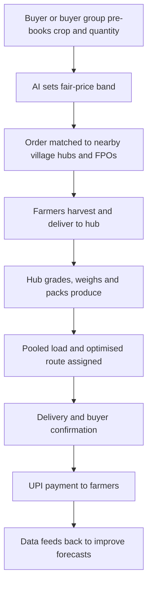
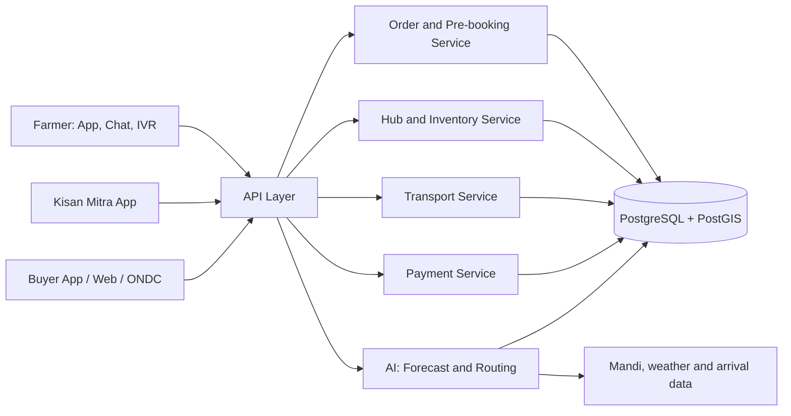

# Smart India Hackathon Workshop

# Date: 24 November 2026

## Reference Number: 26019369

## Name: GOKUL SP

## Problem Title

SIH 26033: Multiple intermediaries reduce farmers earnings and increase consumer prices.

## Problem Creater's Organization

Ministry of Consumer Affairs, Food & Public Distribution

## Theme

Agriculture, FoodTech & Rural Development

## Problem Description

Expected Solution: Create a digital marketplace that:

• Connects farmers/FPOs directly with consumers and bulk buyers. • Provides logistics support. • Uses AI for demand forecasting and route optimization.

Benefits:

• Better prices for farmers. • Lower prices for consumers. • Reduced supply chain inefficiencies.

## Proposed Solution

**1. Detailed explanation of the proposed solution**

*KisanLink* is a pre-booking based farm-to-buyer marketplace. Instead of farmers harvesting first and searching for a buyer later, buyers commit to orders before or during the crop cycle, so farmers know their price and demand in advance.

- **Pre-booking and forward orders:** Bulk buyers (hotels, retailers, canteens, processors) and neighbourhood consumer groups reserve quantities of a crop for a future date at an agreed price band.
- **Village Hub model:** Each FPO or village runs a small collection hub where produce is weighed, graded and packed. A trained local "Kisan Mitra" operates the hub and helps farmers who are not comfortable with smartphones.
- **Multi-channel access:** Farmers can use the app, a WhatsApp-style chat bot, or an IVR phone call in their own language, so feature phones are also supported.
- **Community group-buying:** Apartments, hostels and housing societies pool weekly orders, which gives farmers bigger and predictable drop volumes.
- **Integrated logistics:** The platform pools loads from nearby hubs and assigns the nearest available vehicle.
- **AI layer:** Forecasts demand and price per crop and district, suggests fair-price bands, and plans pickup and delivery routes.
- **Open and interoperable:** Listings can be published on open commerce networks such as ONDC so that the platform plugs into existing buyer apps.

**2. How it addresses the problem**

- Direct pre-bookings between hubs and buyers replace the chain of traders and commission agents.
- Advance demand visibility reduces distress selling and post-harvest wastage.
- Pooled transport and fewer handling points lower the cost per kg, so consumer prices fall while the farmer's share rises.
- A published fair-price band, built from mandi data and AI forecasts, prevents under-pricing of farmers' produce.
- Payments are made to the farmer's bank account through UPI soon after delivery confirmation.

**3. Innovation and uniqueness of the solution**

- Pre-booking and forward demand model instead of a plain listing site.
- Phone-call (IVR) and chat access for farmers who do not use smartphones.
- Village hubs run by local Kisan Mitras, creating rural jobs and a trusted last-mile touchpoint.
- Group-buying for consumers to make demand predictable.
- Fair-price band with a visible "farmer share" meter for each order.
- Open-network integration instead of a closed, single-vendor marketplace.

## Technical Approach

**1. Technologies to be used**

- **Mobile app:** Flutter (farmer, buyer and Kisan Mitra apps) with offline support
- **Web portal:** React.js and Tailwind CSS (admin and bulk buyer dashboard)
- **Backend:** Python with Django REST Framework, Celery for background jobs
- **Database:** PostgreSQL with PostGIS (location and routing data), Redis for caching, Firebase for notifications
- **AI/ML:** XGBoost and LSTM models for price and demand forecasting, Google OR-Tools for vehicle routing and load pooling
- **Voice and language:** Speech recognition and translation for regional languages, IVR through a telephony provider
- **Payments:** UPI with escrow-style settlement
- **Data inputs:** Agmarknet and e-NAM mandi prices, IMD weather data, past arrival data
- **Deployment:** Docker, cloud hosting, CI/CD with GitHub Actions
- **Security:** OTP login, role-based access control, encrypted data and audit logs

**2. Methodology and process for implementation**

1. Survey farmers, FPOs and buyers in a pilot district and gather price datasets.
2. Design the data model, APIs and simple, icon-driven screens.
3. Build the order and pre-booking engine, then the hub and Kisan Mitra workflow.
4. Train and validate forecasting models and connect the routing engine.
5. Integrate payments, IVR and chat channels.
6. Run a pilot with one FPO cluster for one crop season, measure results and refine.
7. Expand to more crops, hubs and districts.

**Process flow**

**System architecture**

*Working prototype / screenshots: add here.*

## Feasibility and Viability

**1. Analysis of the feasibility of the idea**

- **Technical:** Built on proven tools (Flutter, Django, PostgreSQL, OR-Tools); forecasting uses public mandi and weather data.
- **Operational:** FPOs, cooperatives and self-help groups already exist and can host hubs, so the model builds on existing structures.
- **Financial:** Income from a small service fee per order, transport pooling margin and paid forecasting reports for bulk buyers. The fee stays well below traditional commission rates.
- **Adoption:** Voice and IVR channels remove the smartphone barrier, and group buying gives consumers a clear reason to join.

**2. Potential challenges and risks**

- Farmers or buyers failing to honour pre-booked orders
- Price swings between booking and delivery
- Produce quality variation and grading disputes
- Perishable losses and limited cold storage
- Initial trust and slow digital adoption
- Hub operating cost in the early phase

**3. Strategies for overcoming these challenges**

- Small advance deposits, ratings and penalties for repeated cancellations, with substitute supply from nearby hubs
- Price bands with revision rules instead of fixed prices, based on forecasts
- Standard grading sheets, photo proof at the hub and a quick dispute resolution process
- Priority routing for perishables and tie-ups with existing cold storage
- Onboard through FPOs and Kisan Mitras, with demonstrations at village level
- Start with two or three crops in one district and fund hub costs through pilot grants and service fees

## Impact and Benefits

**1. Potential impact on the target audience**

- **Farmers and FPOs:** Assured demand, a higher share of the consumer price, faster payments and less distress selling.
- **Consumers:** Fresher produce at lower and more stable prices, with clear price breakdowns.
- **Bulk buyers:** Predictable quality and supply through advance contracts.
- **Rural youth and women:** Jobs as Kisan Mitras, graders and drivers.
- **Government:** Real-time data on supply, prices and wastage to support policy.

**2. Benefits of the solution**

- **Economic:** Improved farm income, lower consumer prices, and a smaller margin lost to intermediaries.
- **Social:** Inclusion of small and marginal farmers and of users without smartphones, plus local employment.
- **Environmental:** Less food waste through demand-based harvesting, and lower fuel use through pooled and optimised routes.
- **Operational:** Fewer handling stages, shorter delivery time and better price discovery.

## Research and References

1. e-NAM, National Agriculture Market: https://enam.gov.in
2. Agmarknet, mandi prices and arrivals: https://agmarknet.gov.in
3. ONDC, Open Network for Digital Commerce: https://ondc.org
4. SFAC, support for Farmer Producer Organizations: https://sfacindia.com
5. Google OR-Tools, vehicle routing: https://developers.google.com/optimization/routing
6. XGBoost documentation: https://xgboost.readthedocs.io
7. Bhashini, Indian language technology: https://bhashini.gov.in
